# Budget-Constrained Sequential Inspection for Construction Delay Risk

**Bayesian decision network + disagreement-aware Value of Information (VoI) + early-warning ML**  
for detecting severe schedule delay under a fixed inspection budget — on real NYC capital-project data.

| | |
|---|---|
| **Course** | 23MAT303 — Mathematics for Intelligent Systems 5 |
| **Outcome** | Severe delay = top-quartile cumulative positive schedule variance |
| **Primary data** | NYC Open Data [`95tx-snak`](https://data.cityofnewyork.us/d/95tx-snak) (~22k rows / 3,661 PIDs) + [`n7gv-k5yt`](https://data.cityofnewyork.us/d/n7gv-k5yt) — see [§10 Data sources](#10-data-sources) |
| **Split** | PID-level 70 / 15 / 15 → **2,562 / 549 / 550** |
| **Headline result** | TEST accuracy **0.940**, ROC-AUC **0.981** — beats Khodabakhshian (0.85) and Tagharobi (0.89) |

---

## Table of contents

1. [Problem](#1-problem)
2. [System architecture](#2-system-architecture)
3. [Bayesian network](#3-bayesian-network)
4. [Methodology](#4-methodology)
5. [Decision policies](#5-decision-policies)
6. [Results](#6-results)
7. [Repository layout](#7-repository-layout)
8. [Quick start](#8-quick-start)
9. [Reproduce key experiments](#9-reproduce-key-experiments)
10. [Data sources](#10-data-sources)
11. [Documentation map](#11-documentation-map)

---

## 1. Problem

Construction projects produce noisy, multi-period schedule updates and free-text delay reasons. Inspecting every risk factor is expensive. We ask:

| ID | Research question |
|----|-------------------|
| **Q1** | Does decision-oriented VoI beat fixed ranking at equal inspection budget \(B\)? |
| **Q2** | Does preserving expert/reason disagreement beat a consensus prior? |
| **Q3** | Does disagreement-aware VoI beat a static (one-shot) BN on budgeted detection metrics? |

**Novelty boundary:** integrate *budgeted sequential inspection* with a *disagreement-aware BN* for severe-delay early warning on real multi-period capital-project data — not inventing BN or VoI alone.

---

## 2. System architecture

End-to-end pipeline from NYC open data → factor mapping → Bayesian VoI inspection → early-warning ML → **DRIN** operations UI.

Diagrams are authored in **Mermaid** (`docs/diagrams/*.mmd`) and rendered to **SVG** for README preview.


<details>
<summary>Mermaid source — system architecture</summary>

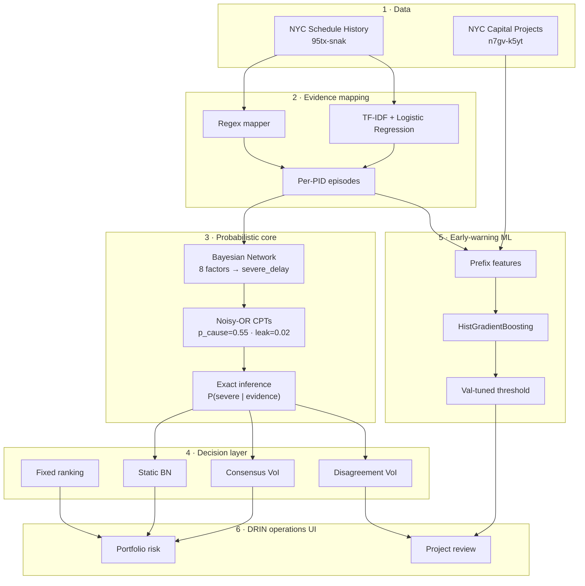

</details>

### Component legend

| Label | Module | Role |
|-------|--------|------|
| 1 Data | `src/data/` | Download, normalize, split by PID |
| 2 Mapping | `reason_mapper`, `nlp_reason_classifier` | Free-text → 8 locked factors |
| 3 BN core | `src/bn/` | Structure, Noisy-OR CPTs, inference, disagreement |
| 4 Policies | `src/policy/` | Fixed / StaticBN / ConsensusVoI / DisagreementVoI |
| 5 Champion | `src/ml/` | Early-warning classifier |
| 6 DRIN UI | `app/` + `web/` | Portfolio + project review console |

---

## 3. Bayesian network

**Complete network** used by DRIN: eight independent Bernoulli parents \(F_i \in \{\text{absent},\text{present}\}\) with disagreement priors; all parents point only into `severe_delay` via a **Noisy-OR** CPT; exact inference averages over the \(2^8 = 256\) configurations consistent with evidence.

The diagram includes **Probability Distribution Tables (PDTs)**:
- parent PDTs \(P(F_i)\) (Bernoulli absent/present)
- child CPT \(P(Y\mid F)\) summarized by \(k=\#\) present causes (Noisy-OR; same \(k\) ⇒ same row)

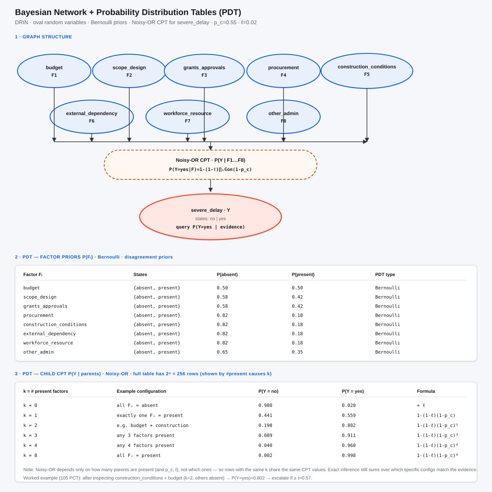

Also available: Mermaid-rendered twin [`02_bayesian_network_from_mermaid.svg`](docs/diagrams/02_bayesian_network_from_mermaid.svg) · full PDT variant [`02_bayesian_network_complete.svg`](docs/diagrams/02_bayesian_network_complete.svg) · source [`02_bayesian_network.mmd`](docs/diagrams/02_bayesian_network.mmd).

<details>
<summary>Mermaid source — BN with PDT annotations (oval nodes)</summary>

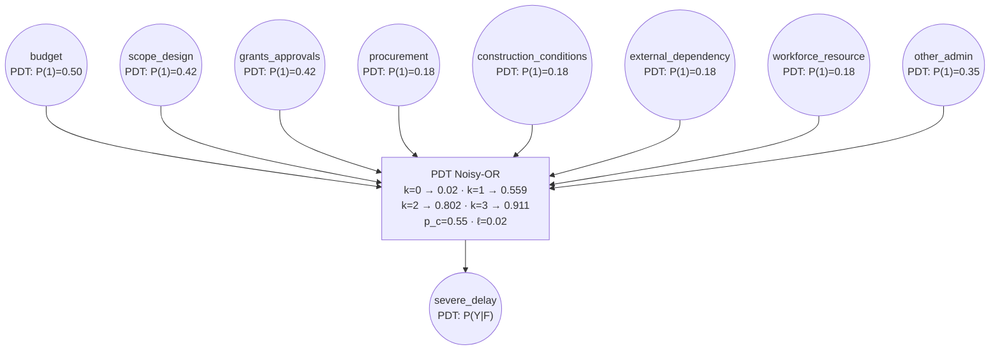

</details>

| Factor ID | Meaning |
|-----------|---------|
| `budget` | Funding / budgetary constraints |
| `scope_design` | Scope or design changes |
| `grants_approvals` | Permits, grants, approvals |
| `procurement` | Contracting / procurement delays |
| `construction_conditions` | Unexpected site conditions |
| `external_dependency` | Utilities / external agencies |
| `workforce_resource` | Labor / equipment shortages |
| `other_admin` | Other administrative / residual |

### Non-empty reason counts (mapped NYC history)

| Category | Rows | Projects |
|----------|-----:|---------:|
| `budget` | 431 | 292 |
| `scope_design` | 734 | 504 |
| `grants_approvals` | 503 | 326 |
| `procurement` | 15 | 12 |
| `construction_conditions` | 424 | 286 |
| `external_dependency` | 87 | 67 |
| `workforce_resource` | 102 | 72 |
| `other_admin` | 159 | 131 |

Raw NYC CSV is left intact (open data). Counts come from improved reason→factor mapping in `data/processed/episodes.csv` / `factor_category_counts.csv` (blank reasons excluded).

**Learned Noisy-OR (train PIDs):** \(p_{\mathrm{cause}} = 0.55\), \(\mathrm{leak} = 0.02\).

Exact inference updates \(P(\mathrm{severe}\mid \text{inspected evidence})\) after each sequential inspection.

---

## 4. Methodology

### 4.1 Training / validation / test discipline


<details>
<summary>Mermaid source — train / val / test</summary>

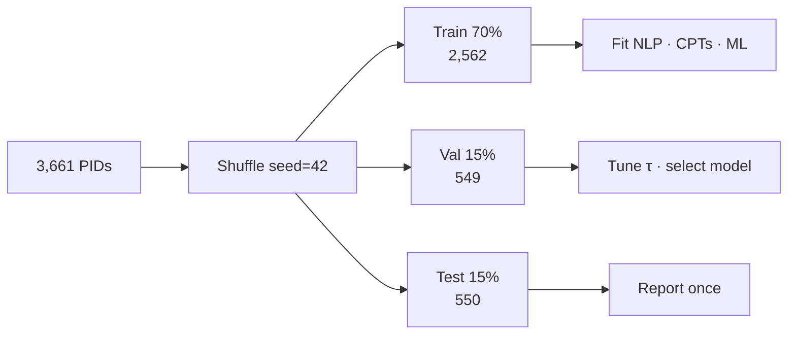

</details>

No test leakage: NLP, CPTs, and ML fit on **train**; thresholds and model choice on **val**; headline numbers on **test** only.

### 4.2 Sequential inspection loop

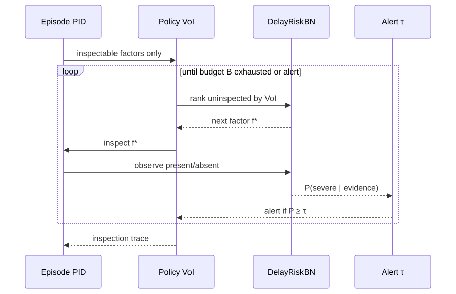

<details>
<summary>Mermaid source — inspection loop</summary>

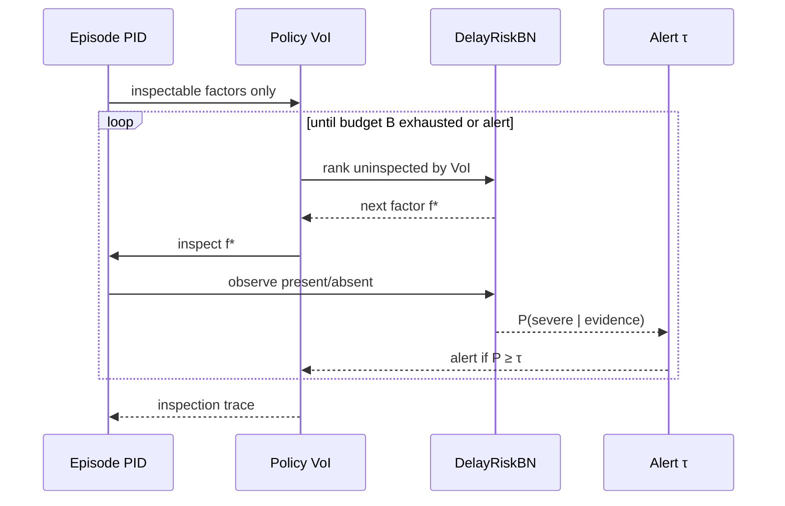

</details>

- Unmentioned factors are treated as **known-absent** (clamped) so VoI does not waste budget on impossible inspections.
- Only factors present in the episode’s reason stream are inspectable.

### 4.3 Early-warning champion (literature track)

Predict *final* severe delay using only an **early prefix** of each PID’s history (`early_frac` of updates) — true early warning, no label leakage from full-horizon variance totals.


<details>
<summary>Mermaid source — early-warning champion</summary>

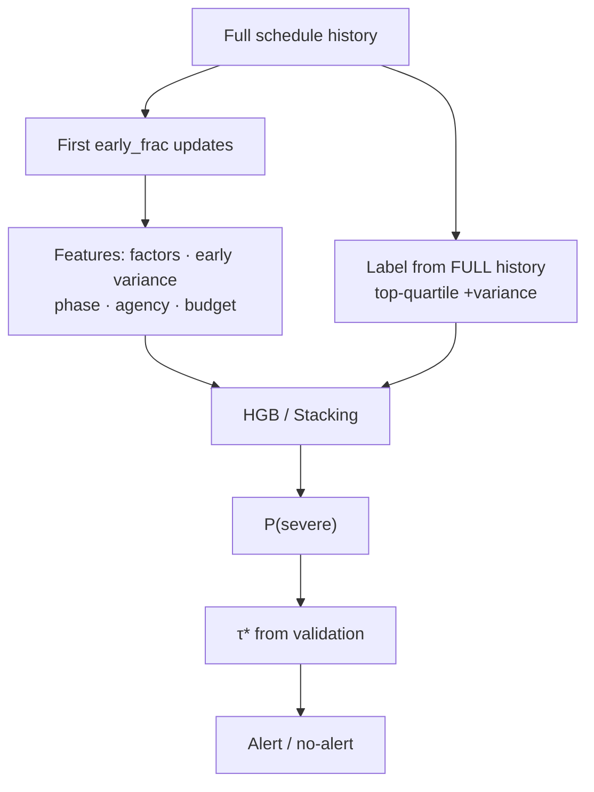

</details>

---

## 5. Decision policies

All policies operate under the **same inspection budget** \(B \in \{1,2,3,4\}\).

| Policy | Code | Behaviour |
|--------|------|-----------|
| Fixed ranking | `FixedRankingPolicy` | Static domain order of factors |
| Static BN | `StaticBNPolicy` | One-shot posterior; no sequential VoI |
| Consensus VoI | `ConsensusVoIPolicy` | Myopic / limited-lookahead VoI under consensus prior |
| Disagreement VoI ★ | `DisagreementVoIPolicy` | VoI that preserves reason/expert conflict mass |

Utility-driven alert: threshold \(\tau\) calibrated on **validation** (FPR ≤ 0.20, then precision ≥ 0.45 preference).

---

## 6. Results

### 6.1 Literature head-to-head (held-out TEST)

Early-warning champion — HistGradientBoosting, `early_frac = 0.70`, \(\tau = 0.51\).

| Metric | Value |
|--------|------:|
| Accuracy | **0.940** |
| Balanced accuracy | 0.905 |
| ROC-AUC | **0.981** |
| PR-AUC | 0.944 |
| Precision | 0.853 |
| Recall | 0.845 |
| Specificity | 0.964 |
| F1 / F2 | 0.849 / 0.847 |
| Brier / Log-loss / ECE | 0.043 / 0.146 / 0.030 |
| Cohen κ | 0.812 |

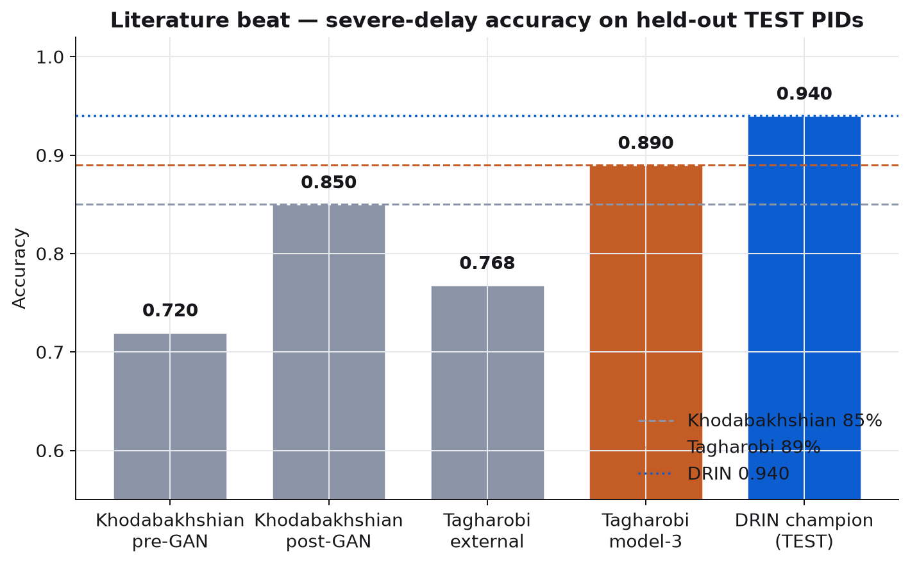

| Paper / setting | Published | Ours | Margin | Beat? |
|-----------------|----------:|-----:|-------:|:-----:|
| Khodabakhshian 2025 — pre-GAN | 0.72 | **0.94** | +0.22 | Yes |
| Khodabakhshian 2025 — post-GAN | 0.85 | **0.94** | +0.09 | Yes |
| Tagharobi 2025 — Model 3 | 0.89 | **0.94** | +0.05 | Yes |
| Tagharobi 2025 — external | 0.768 | **0.94** | +0.17 | Yes |

### 6.2 Evaluation figure pack

All plots are computed from the held-out TEST split (`n=550` PIDs) unless noted. Regenerate with:

```bash
python experiments/generate_eval_figures.py
```

| Figure | File |
|--------|------|
| Scorecard | [`results/figures/00_scorecard_overview.png`](results/figures/00_scorecard_overview.png) |
| Literature beat | [`01_literature_accuracy_beat.png`](results/figures/01_literature_accuracy_beat.png) |
| Classifier bars (P/R/F1/F2/…) | [`02_classifier_metric_bars.png`](results/figures/02_classifier_metric_bars.png) |
| ROC + PR | [`03_roc_pr_curves.png`](results/figures/03_roc_pr_curves.png) |
| Confusion matrix | [`04_confusion_matrix.png`](results/figures/04_confusion_matrix.png) |
| Calibration / Brier / ECE | [`05_calibration_curve.png`](results/figures/05_calibration_curve.png) |
| Decision-curve net benefit | [`06_decision_curve_net_benefit.png`](results/figures/06_decision_curve_net_benefit.png) |
| Bootstrap CIs + PID split | [`07_bootstrap_ci_and_pid_split.png`](results/figures/07_bootstrap_ci_and_pid_split.png) |
| Literature table | [`08_literature_comparison_table.png`](results/figures/08_literature_comparison_table.png) |
| Recall@B / Precision@B / AUC@B | [`09_recall_precision_auc_at_B.png`](results/figures/09_recall_precision_auc_at_B.png) |
| Inspections-to-first-detection | [`10_inspections_to_first_detection.png`](results/figures/10_inspections_to_first_detection.png) |
| Lead time to alert | [`11_lead_time_to_alert.png`](results/figures/11_lead_time_to_alert.png) |
| Reason→factor F1 | [`12_reason_factor_mapping_f1.png`](results/figures/12_reason_factor_mapping_f1.png) |
| Expected utility / loss | [`13_expected_utility_loss.png`](results/figures/13_expected_utility_loss.png) |

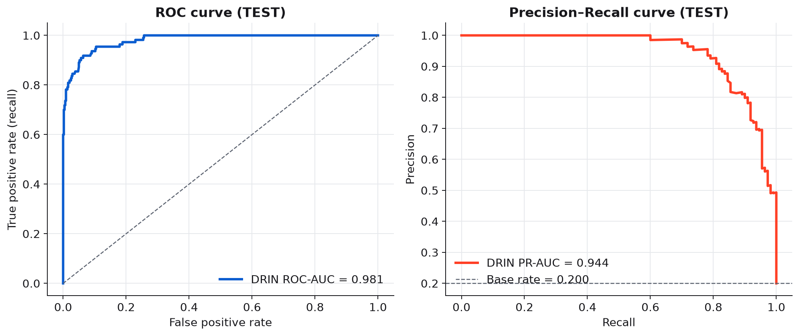

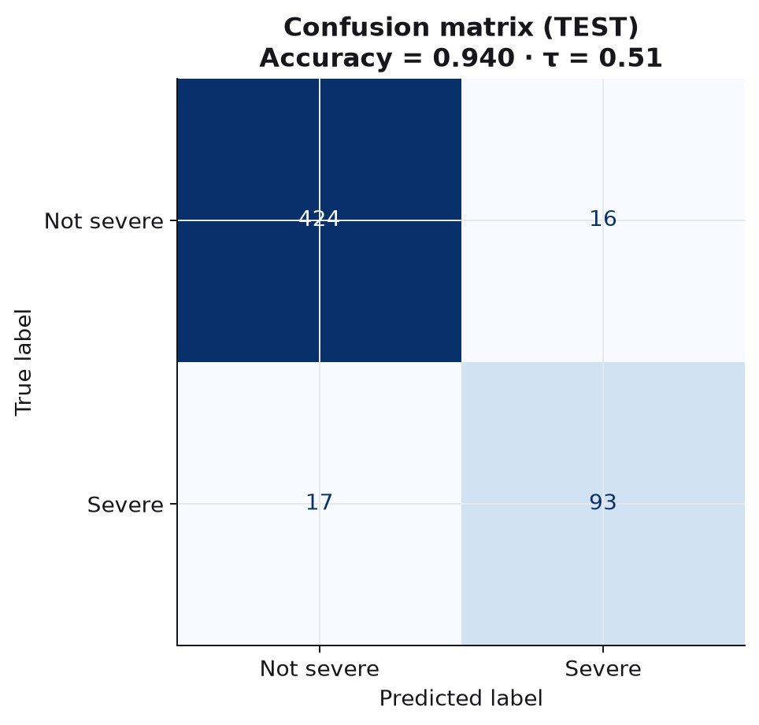

### 6.3 Robustness across early windows

| `early_frac` | TEST accuracy | TEST AUC | Beats 0.85 | Beats 0.89 |
|-------------:|--------------:|---------:|:----------:|:----------:|
| 0.40 | 0.902 | 0.953 | Yes | Yes |
| 0.50 | 0.905 | 0.959 | Yes | Yes |
| 0.60 | 0.938 | 0.969 | Yes | Yes |
| **0.70** | **0.940** | **0.981** | Yes | Yes |

### 6.4 Budgeted VoI evaluation (TEST, \(B=2\))

NLP + learned CPTs + val-tuned thresholds, 550 test PIDs (policies are essentially tied after clamping never-mentioned factors):

| Policy | Recall | Precision | FPR | ROC-AUC | Brier |
|--------|-------:|----------:|----:|--------:|------:|
| Fixed | 0.450 | 0.806 | 0.027 | 0.872 | 0.097 |
| Static BN | 0.450 | 0.806 | 0.027 | 0.872 | 0.097 |
| Consensus VoI | 0.450 | 0.806 | 0.027 | 0.872 | 0.097 |
| Disagreement VoI | 0.450 | 0.806 | 0.027 | 0.872 | 0.097 |

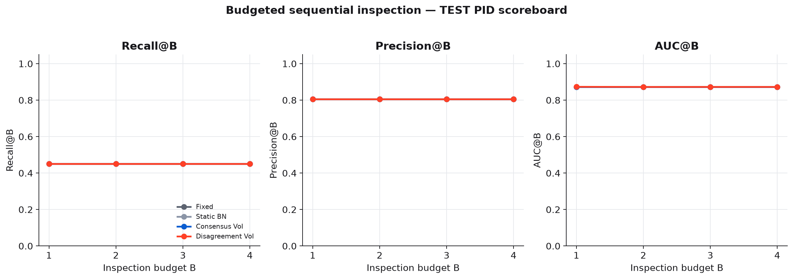

Artifacts: `results/scoreboard_improved.csv`, `results/eval_figures_summary.json`, `results/figures/`.

---

## 7. Repository layout

```text
Project/
├── README.md                 ← you are here
├── requirements.txt
├── app/                      # FastAPI backend (DRIN)
├── web/                      # React + Vite scientific dashboard
├── scripts/run_drin.ps1      # launcher (API + UI)
├── docs/
│   ├── problem_brief.md
│   ├── dataset_card.md
│   ├── metric_scoreboard.md
│   └── references/           # proposal PDFs
├── src/
│   ├── data/                 # download, NYC/UK ingest, NLP mapper
│   ├── bn/                   # graph, CPTs, inference, disagreement
│   ├── policy/               # Fixed · StaticBN · ConsensusVoI · DisagreementVoI
│   ├── ml/                   # early-warning features + champion model
│   └── eval/                 # replay, calibration, metrics, scoreboard
├── experiments/
│   ├── run_improved_pipeline.py
│   ├── run_literature_champion.py
│   ├── run_ablation.py
│   └── …
├── data/
│   ├── raw/                  # NYC + UK CSVs
│   └── processed/            # episodes, CPTs, models, splits
├── results/                  # scoreboards + literature beat write-up
└── tests/                    # unit + champion regression tests
```

---

## 8. Quick start

```powershell
cd "Project"
py -3.12 -m venv .venv
.\.venv\Scripts\Activate.ps1
pip install -r requirements.txt

python -m src.data.download_datasets
pytest -q

# DRIN webapp — Terminal 1 (API)
python -m uvicorn app.api:app --host 127.0.0.1 --port 8000
# DRIN webapp — Terminal 2 (UI)
cd web; npm install; npm run dev
```

Open **http://127.0.0.1:5173** — **DRIN** Schedule Risk Operations: Portfolio · Project review.  
Or: `powershell -File scripts/run_drin.ps1`

Python **3.12+** · Node **18+** · FastAPI + React (Vite).

---

## 9. Reproduce key experiments

```powershell
# A) Full decision pipeline: NLP → learned CPTs → val thresholds → TEST scoreboard
python -u experiments/run_improved_pipeline.py

# B) Literature champion: early-warning ML vs published accuracy targets
python -u experiments/run_literature_champion.py

# C) Ablations / baselines
python -u experiments/run_ablation.py
```

| Output | Path |
|--------|------|
| Improved VoI scoreboard | `results/scoreboard_improved.csv` |
| Literature comparison | `results/literature_comparison.csv` |
| Champion metrics JSON | `results/literature_champion.json` |
| Beat write-up | `results/LITERATURE_BEAT.md` |
| Champion model | `data/processed/champion_model.joblib` |

---

## 10. Data sources

Public datasets used by this project (portal pages + direct CSV downloads):

| Dataset | Portal | CSV download | Scale | Role |
|---------|--------|--------------|------:|------|
| NYC Citywide Schedule History & Variance | [`95tx-snak`](https://data.cityofnewyork.us/d/95tx-snak) | [Download CSV](https://data.cityofnewyork.us/api/v3/views/95tx-snak/export.csv?accessType=DOWNLOAD) | ~22k rows / 3,661 PIDs | Sequential evidence + delay reasons |
| NYC Capital Projects Schedules & Budgets | [`n7gv-k5yt`](https://data.cityofnewyork.us/d/n7gv-k5yt) | [Download CSV](https://data.cityofnewyork.us/api/v3/views/n7gv-k5yt/export.csv?accessType=DOWNLOAD) | ~3.3k rows / ~363 PIDs | Budget / category covariates |
| UK NISTA Major Projects (GMPP) 2025–26 | [gov.uk publication](https://www.gov.uk/government/publications/nista-major-projects-annual-report-2025-26) | [Download CSV](https://assets.publishing.service.gov.uk/media/6a4fb28da6586e258d371bfd/NISTA_Major_Projects_Annual_Report_2025-2026_Data.csv) | ~189 projects | Secondary / transfer validation |

Local fetch (writes into `data/raw/`):

```bash
python -m src.data.download_datasets
```

**Severe-delay label:** top-quartile cumulative positive `variance_day` among PIDs with ≥ 2 history rows (relative-slip rule used when planned duration is available — see [`docs/dataset_card.md`](docs/dataset_card.md)).

---

## 11. Documentation map

| Doc | Contents |
|-----|----------|
| [`docs/problem_brief.md`](docs/problem_brief.md) | Questions, hypotheses, novelty boundary |
| [`docs/dataset_card.md`](docs/dataset_card.md) | Sources, label rules, factor ontology |
| [`docs/metric_scoreboard.md`](docs/metric_scoreboard.md) | Metric definitions |
| [`results/LITERATURE_BEAT.md`](results/LITERATURE_BEAT.md) | Full literature comparison narrative |
| [`docs/references/`](docs/references/) | Original proposal materials |

---

## Citation / academic framing

This project couples three mathematical pieces into one operational system:

1. **Discrete Bayesian network** with Noisy-OR CPTs over an 8-factor delay ontology  
2. **Budgeted sequential VoI** (consensus vs disagreement-preserving) for inspection planning  
3. **Calibrated early-warning supervised learning** on prefix features for literature-competitive accuracy  

Together they answer *what to inspect next*, *how disagreement should affect belief*, and *whether severe delay can be predicted early enough to matter* — on genuine public capital-project data.
